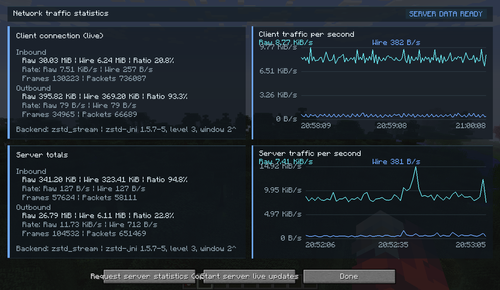

# NeverEnoughBandwidthLegacy

English | [简体中文](README_zh_CN.md)

A network optimization mod for Minecraft 1.7.10, designed to improve multiplayer gameplay on bandwidth-limited servers.

> [!NOTE]
> This is a 1.7.10 port of NEB ([NotEnoughBandwidth](https://github.com/USS-Shenzhou/NotEnoughBandwidth)). Please report issues with this port to this repository, rather than to NEB.

## Download

| GTNH Version | Mod Version | Status                 | Download                                                                                                                                |
|--------------|-------------|------------------------|-----------------------------------------------------------------------------------------------------------------------------------------|
| 2.9.0 RC2    | 1.0.0+      | ✅ Actively Maintained | [](https://github.com/ABKQPO/NeverEnoughBandwidthLegacy/releases/latest) |

## Traffic statistics screen

Default shortcut: `Alt+N`



## Features

### ZSTD Streaming Compression

`ZstdStreamCodec` retains a Zstandard compression context per connection, reusing history across aggregate frames to compress subsequent traffic using previously transmitted data. The server can also use `BandwidthDictionary` to train compression dictionaries from each connection's traffic, adopting them only when validation shows savings that justify their transfer cost.

The client and server exchange capabilities through `HelloMessage`, while `NebSession` manages the negotiation result and connection contexts. Available backends include ZSTD streaming, independent ZSTD blocks, Deflate streaming, and vanilla packet passthrough. Traffic stays on the vanilla path until negotiation completes. Independent blocks and streams that have not warmed up can fall back to original packets when compression provides no savings; stream context resets are synchronized with the receiver.

### Smaller Packet Headers

NEB compresses the `Identifier` type headers at the shared `CustomPacketPayload` codec entry point. In 1.7.10, mod payloads are carried by `S3FPacketCustomPayload` (server to client) and `C17PacketCustomPayload` (client to server). This port identifies channel names in their serialized bytes and replaces repeated names with compact indices, preserving message IDs and data inside the payload.

Forge 1.7.10 lacks modern NeoForge's unified registry of payload types and codecs, so `ChannelIndex` learns a dictionary dynamically for each direction of each connection: the first occurrence defines the channel name, and subsequent packets reference it with a 1–2 byte VarInt inside compressed aggregate frames. Matching registration orders are not required.

This 1–2 byte figure covers only the channel name replacement, not the entire packet header. Each dictionary holds up to 4096 channels; new channels beyond that limit retain their full names. The receiver restores channel names before vanilla/Forge decoding, so other mods do not need to change their networking code.

### Packet Aggregation

Combines small packets sent within a short interval and compresses them together to share compression overhead. The default aggregation window is 20 milliseconds; streaming codecs may hold very small batches longer to improve compression efficiency.

Lifecycle hooks in `NetworkManager` and Forge's `NetworkDispatcher` install the pipeline. `PacketAggregator` collects packet bodies already encoded by vanilla's `MessageSerializer` and writes them into aggregate `NebFrame` frames. On receipt, `PacketExpander` runs after the `MessageDeserializer2` frame splitter, decompresses the data, restores channel names, and returns individual packet bodies to the vanilla packet decoder.

> [!NOTE]
> A regular compressed aggregate frame has the following structure; the second layout shows the subpackets before compression:
>
> ```text
> +---+---+---+-------------------------------------+
> | S | H | R |          compressed data            |
> +---+---+---+-------------------------------------+
>
>             +----+----+----+----+----+----+-----+
>             | s0 | p0 | d0 | s1 | p1 | d1 | ... |
>             +----+----+----+----+----+----+-----+
>             |-- packet 0 --|-- packet 1 --|
> ```
>
> - `S`: VarInt, outer frame length, excluding `S` itself.
> - `H`: 1 byte, containing the NEB marker, compression backend, and context reset flag.
> - `R`: VarInt, aggregate data size before compression, after channel indexing has been applied.
> - `s`: VarInt, total byte length of this subpacket's `p + d`.
> - `p`: Vanilla packet ID (VarInt); custom payloads also include the channel token and, for definitions or unindexed channels, the channel name.
> - `d`: Remaining data for this subpacket.
>
> The entire `s0 + p0 + d0 + s1 + p1 + d1 + ...` sequence is compressed into `compressed data`.

Channels and packet types requiring immediate delivery can bypass aggregation; buffered packets are sent first to preserve ordering. Oversized individual packets follow the vanilla path, and aggregate frames reach downstream handlers only after packet lengths and channel indices have been validated.

### Delayed Chunk Cache

Temporarily retains chunks that have just left a player's view to reduce full chunk retransmissions when moving back and forth nearby. By default, each player can retain up to 128 additional chunks, within 2 chunks beyond the view distance, for up to 10 seconds.

The cache retains and restores chunks through subscription hooks in `PlayerManager` and its inner class `PlayerInstance`. Retained chunks continue receiving block updates, while `isPlayerWatchingChunk` excludes the extra retained chunks to avoid extending normal entity tracking. Time, distance, and capacity limits, or player departure, trigger cleanup through the vanilla removal path without replacing chunk writers.

## Commands

| Command                      | Usage                 |
|------------------------------|-----------------------|
| View server statistics       | `/neb stat`           |
| Export a server report       | `/neb report`         |
| Reset server statistics      | `/neb reset`          |
| View available codecs        | `/neb codec`          |
| Check dataset capture status | `/neb capture status` |
| Start capture                | `/neb capture start`  |
| Stop capture                 | `/neb capture stop`   |

## Configuration

The configuration file is `config/notenoughbandwidth.cfg`. On the client, a configuration screen is also available from the mod list.

Values below are defaults. The client and server each read their local configuration; the server selects a compression backend supported by both peers. Chunk caching and per-player context settings are used on the server. After editing the file, restart the relevant client or server so negotiation, codecs, and bypass rules are initialized with the new settings.

### enabled

Defaults to `true`. Controls whether the optimization pipeline is enabled. Changing this option requires a client/server restart.

### codec

Defaults to `auto`, which is recommended. The selected backend must be supported by both peers.

| Value            | Description                                                                       |
|------------------|-----------------------------------------------------------------------------------|
| `auto`           | Selects a backend based on the runtime and peer capabilities.                     |
| `zstd_stream`    | Reuses ZSTD compression history across frames.                                    |
| `zstd_block`     | Compresses each frame independently, without cross-frame history.                 |
| `deflate_stream` | Uses the JDK's Deflate stream without requiring the ZSTD native library.          |
| `stored`         | Passes through vanilla packets without aggregate compression or channel indexing. |

### aggregationWindowMillis, smallPacketCoalescingMillis

Controls aggregation and small-packet waiting times, in milliseconds.

| Option                        | Default | Description                                                                                                                                   |
|-------------------------------|---------|-----------------------------------------------------------------------------------------------------------------------------------------------|
| `aggregationWindowMillis`     | `20`    | Normal aggregation window, from 0 to 200; 0 only merges packets processed consecutively by the EventLoop without deliberately adding a delay. |
| `smallPacketCoalescingMillis` | `80`    | Allows very small batches using streaming compression to wait up to this time limit, from 0 to 500; 0 disables this extended wait.            |

Longer waits can improve small-packet compression at the cost of latency.

### flushThresholdBytes, compressionThresholdBytes, maxExpandedFrameBytes

| Option                      | Default             | Description                                                                                                           |
|-----------------------------|---------------------|-----------------------------------------------------------------------------------------------------------------------|
| `flushThresholdBytes`       | `262144` (256 KiB)  | Sends buffered data early once this size is reached; aggregate data also has a hard limit of 1 MiB.                   |
| `compressionThresholdBytes` | `64`                | Independent frames below this size are not compressed; streaming codecs may attempt smaller batches after coalescing. |
| `maxExpandedFrameBytes`     | `16777216` (16 MiB) | Limits the decompressed/restored size of received frames and also bounds outbound aggregation size.                   |

### unaggregatedChannels, unaggregatedPacketTypes

Specifies channel names and packet class names that stay on the vanilla path, bypassing aggregation and compression. The default channels are `FML|HS`, `REGISTER`, `UNREGISTER`, and `MC|Brand`. Packet types accept fully qualified or simple class names; defaults include selected latency-sensitive entity, movement, and chat packets.

> [!NOTE]
> Bypassed packets trigger a send of buffered data first to preserve ordering. Numerous or frequent bypasses reduce aggregation efficiency. Changing either list requires a restart.

### zstdLevel, zstdWindowLog

| Option          | Default | Description                                                                                             |
|-----------------|---------|---------------------------------------------------------------------------------------------------------|
| `zstdLevel`     | `3`     | ZSTD compression level, from 1 to 19; higher levels generally save more bandwidth at a higher CPU cost. |
| `zstdWindowLog` | `22`    | Base-2 logarithm of the ZSTD streaming history window, from 17 to 27; 22 corresponds to a 4 MiB window. |

Larger windows increase native memory usage per connection. Both compression and decompression contexts require memory; the window size is not the connection's total memory usage.

### enableBandwidthDictionary

Defaults to `true`. Allows the server to sample traffic and train size-limited ZSTD dictionaries per connection. Updates are sent only when both peers support them, validation shows savings, and distribution conditions are met; dictionaries are not sent unconditionally to every connection.

### delayedChunkCache, delayedChunkCacheSize, delayedChunkCacheDistance, delayedChunkCacheSeconds

> [!NOTE]
> These chunk cache settings are used on the server.

| Option                      | Default | Description                                                                                          |
|-----------------------------|---------|------------------------------------------------------------------------------------------------------|
| `delayedChunkCache`         | `true`  | Enables the delayed chunk cache; changing this requires a restart.                                   |
| `delayedChunkCacheSize`     | `128`   | Maximum additional retained chunks per player, from 0 to 2048; 0 disables retention.                 |
| `delayedChunkCacheDistance` | `2`     | Additional retention distance beyond the view radius, in chunks, from 0 to 16; 0 disables retention. |
| `delayedChunkCacheSeconds`  | `10`    | Maximum retention time after a chunk leaves view, from 1 to 120 seconds.                             |

Larger distances, capacities, and retention times can reduce retransmissions when revisiting areas, at the cost of additional server and client resources.

### playersWithoutContext

A server setting, empty by default. Accepts player names or UUIDs, matched case-insensitively. Listed players negotiate a backend without cross-frame compression history to reduce context memory usage, potentially lowering compression efficiency.

### collectPacketProfile, datasetCaptureSeconds, datasetCaptureMiB, debugLog

| Option                  | Default | Description                                                                             |
|-------------------------|---------|-----------------------------------------------------------------------------------------|
| `collectPacketProfile`  | `true`  | Records statistics by packet type and mod channel for detailed reports.                 |
| `datasetCaptureSeconds` | `120`   | Default dataset capture duration, from 1 to 3600 seconds.                               |
| `datasetCaptureMiB`     | `64`    | Maximum captured payload size per dataset, from 1 to 1024 MiB.                          |
| `debugLog`              | `false` | Logs per-frame compression ratios at debug level; recommended only for troubleshooting. |

## Credit

Thanks to USS_Shenzhou and the contributors to the original [NotEnoughBandwidth](https://github.com/USS-Shenzhou/NotEnoughBandwidth) for the foundation and ideas behind this project's packet optimizations.
