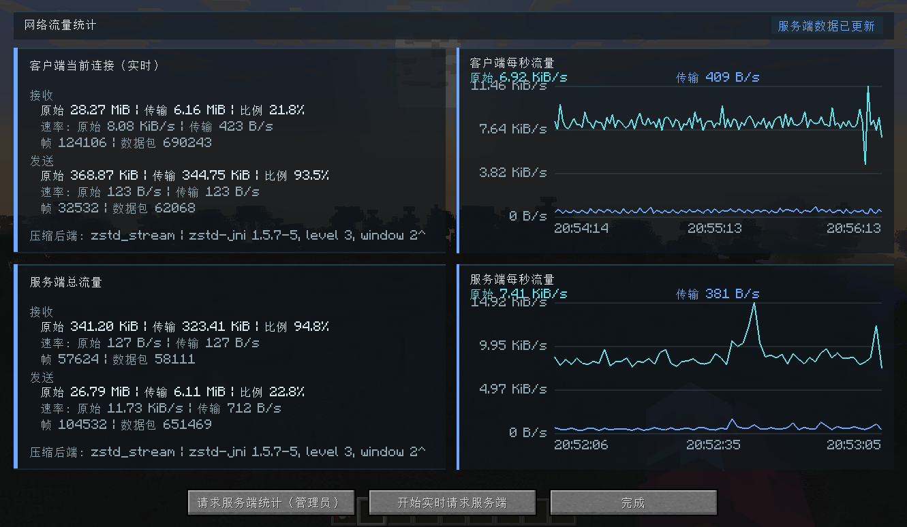

# NeverEnoughBandwidthLegacy

[English](README.md) | 简体中文

Minecraft 1.7.10 的网络包优化 MOD，旨在改善服务器带宽受限时的多人联机体验。

> [!NOTE]
> 这是 NEB（[NotEnoughBandwidth](https://github.com/USS-Shenzhou/NotEnoughBandwidth)）的 1.7.10 移植版。使用本 MOD 时遇到的问题，请提交到本仓库；请勿提交到 NEB。

## 下载

| GTNH 版本 | Mod 版本 | 状态      | 下载                                                                                                                                    |
|-----------|----------|-----------|-----------------------------------------------------------------------------------------------------------------------------------------|
| 2.9.0 RC2 | 1.0.0+   | ✅ 维护中 |  |

## 统计界面

默认按键 `Alt+N`

## 功能

- **ZSTD 流压缩**：跨数据包复用压缩上下文，减少重复数据占用的带宽。
- **更小包头**：使用紧凑通道索引替代重复的通道名称，降低模组网络包的包头开销。
- **包聚合**：将短时间内的小包合并压缩发送，减少逐包传输的开销。
- **区块缓存**：暂时保留玩家刚离开的区块，减少返回附近区域时重复发送完整区块的数据量。

## 指令

| 指令               | 用法                  |
|--------------------|-----------------------|
| 查看服务端统计     | `/neb stat`           |
| 导出服务端报告     | `/neb report`         |
| 清空服务端统计     | `/neb reset`          |
| 查看数据集采集状态 | `/neb capture status` |
| 开始采集           | `/neb capture start`  |
| 停止采集           | `/neb capture stop`   |

---

## 与 NEB 原版的差异

针对 Forge 1.7.10 的网络栈，本项目重新实现了通道索引、聚合帧和连接协商。主要技术差异如下。

### 在没有统一网络注册表时接入包管线

原版 NEB 从 NeoForge 协商得到的 PLAY 通道列表及 payload 注册信息中筛选、排序，建立 `namespace-id + path-id` 两级索引，并修改 `CustomPacketPayload` 的公共编解码入口。Forge 1.7.10 虽然有通道注册机制，却没有与之对应的、覆盖模组 payload 类型和 codec 的统一注册表，无法直接照搬这一实现。

本项目通过 `NetworkManager` 和 Forge `NetworkDispatcher` 的生命周期 Mixin 安装 Netty handler：`PacketAggregator` 放在 `MessageSerializer` 之前，`PacketExpander` 放在拆帧器 `MessageDeserializer2` 之后。Netty 出站按反向顺序执行，因此聚合器实际接收的是原版编码器已经输出的字节，而接收端在原版包解码前还原字节。管线锚点同时按名称和类型查找，安装与重试在连接的 EventLoop 上执行，并跳过本地通道。

### 包头压缩采用连接内通道字典

本项目从当前连接的发送 / 接收协议表定位 `S3FPacketCustomPayload`、`C17PacketCustomPayload` 的包 ID，再在序列化后的包体中识别通道名。索引粒度是整个通道字符串，模组在 payload 内部使用的消息编号和数据保持不变。每条连接的两个传输方向分别维护字典，按首次出现顺序分配 ID，无需双方预先拥有相同的注册顺序：

* 首次出现：发送 VarInt token `(id << 1) | 1`，随后附带通道名的 UTF-8 字节长度和名称，供接收端定义索引。
* 后续引用：只发送 VarInt token `id << 1`。ID 为 1~63 时 token 占 1 字节，其余已分配 ID 占 2 字节；这仅指替换通道名的部分，不含原版包 ID 和帧头。
* 字典最多容纳 4096 个通道；满后新通道使用 token `0` 携带完整名称，已有通道仍可引用。绕过聚合的包保持原版格式。

上述替换仅用于压缩聚合帧。接收端检查定义顺序、索引范围和名称长度，再恢复原版通道名，将包交回原版 / Forge 解码路径，其他模组无需修改序列化代码。如果一次压缩尝试最终改为发送原包，发送端会回滚本次新增索引，避免引用对端尚未收到的定义；连接结束时清理字典。这里的通道索引与 Zstandard 压缩字典是两套独立机制。

### 聚合边界和顺序保证不同

原版 NEB 在 `Connection.send` 层收集包对象，通过其类型和 codec 写入自定义聚合 payload。本项目在编码后的字节层收集包，以连续的 `VarInt 长度 + 原版包体` 组成聚合数据，再添加 codec / 上下文重置标志及解压长度等帧信息。接收端完成解压、通道名恢复后，将各个包体交给原版解码器。

聚合缓冲和定时发送由各连接的 EventLoop 管理；绕过包、过大单包和连接关闭前先发送已缓冲内容，以保持顺序。帧大小同时受 Minecraft 外层长度限制和解压大小配置约束，超过聚合上限的单包走原版路径。接收端先验证子包长度，并在全部子包拆分、通道索引还原成功后才交给下游；解析失败时释放临时缓冲并抛出异常。

### 压缩后端与上下文同步

原版 NEB 使用 ZSTD 上下文，并可按玩家关闭上下文复用。本项目将压缩器抽象为 codec，通过 `HelloMessage` 交换协议版本、能力和服务端选择，再经客户端确认启用。可选后端包括 Zstandard 流、Zstandard 独立块、Deflate 流及原包直通；选择依据是双方实际可用能力和配置，协商未完成时保持原版发送路径。

对于独立块或尚未预热的流，压缩后没有收益时可改发原包；如果流压缩器已经消费了本批数据，则重建发送上下文，并在下一压缩帧标记重置，让接收端同步。已预热的流允许个别帧略微膨胀，以保留后续压缩所需的历史。此外，服务端可从流量样本训练共享 Zstandard 字典，在双方支持且满足下发条件时，先发送字典更新帧，再使用新字典编码后续数据。

### 延迟区块缓存的接入方式

原版 NEB 重写 `ChunkMap` 的追踪视图更新逻辑。本项目则在 1.7.10 的 `PlayerManager` / `PlayerInstance` 添加保留与恢复钩子：玩家移动时暂缓移除已发送区块的订阅，返回时复用已有区块并补充实体追踪；超时、超距、超量或玩家离开时，调用原版移除路径清理。缓存区块会从 `isPlayerWatchingChunk` 的结果中排除，避免把额外保留范围当作正常实体追踪范围。批量区块包的 ChunkAPI 兼容读取另由独立 Mixin 处理，不替换区块写入器。
